## Rapport de projet — Application de Digital Banking Micro-Services

**Module :** Systèmes distribués et Architectures Orientées Micro Services  
**Année universitaire :** 2025–2026  
**Étudiant :** Mohamed Zouhair ROUISSIYA

---

## Table des matières

1. [Introduction](#1-introduction)
2. [Architecture globale](#2-architecture-globale)
3. [Technologies utilisées](#3-technologies-utilisées)
4. [Backend — Spring Boot et Spring Cloud](#4-backend--spring-boot-et-spring-cloud)
5. [Frontend — Angular](#5-frontend--angular)
6. [Chatbot — Spring AI, Ollama et Discord](#6-chatbot--spring-ai-ollama-et-discord)
7. [Sécurité](#7-sécurité)
8. [Diagrammes de conception](#8-diagrammes-de-conception)
9. [Implémentation et démonstration](#9-implémentation-et-démonstration)
10. [Installation et exécution locale](#10-installation-et-exécution-locale)
11. [Tests et validation](#11-tests-et-validation)
12. [Limites et perspectives](#12-limites-et-perspectives)
13. [Conclusion](#13-conclusion)

---

## 1. Introduction

Ce projet consiste en la conception et la réalisation d'une **plateforme de digital banking**, couvrant la gestion des clients, la gestion des comptes courants et des comptes épargne, les mouvements financiers et la consultation de l'historique des opérations.

La première version reposait sur un backend Spring Boot monolithique, un frontend Angular et un chatbot utilisant OpenAI, une approche RAG et Telegram. La version présentée ici constitue une **refonte vers une architecture microservices**, réalisée progressivement en conservant le domaine fonctionnel initial et en réutilisant l'interface Angular.

---

## 2. Architecture globale

### 2.1 Vue d'ensemble

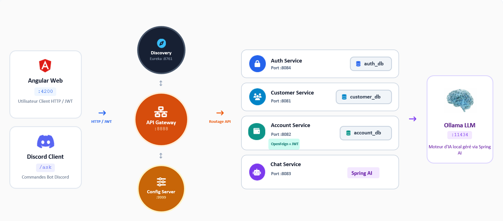

L'architecture sépare les **points d'entrée**, la **logique métier**, l'**authentification**, les **données** et la **génération IA**. Chaque service possède ses propres contrôleurs et règles métier, tandis que Gateway fournit le point d'accès commun aux clients HTTP.

### 2.2 Services et ports

| Composant             | Port local | Responsabilité                                                         |
| --------------------- | ---------: | ---------------------------------------------------------------------- |
| **Discovery Service** |     `8761` | Registre Eureka et découverte des instances                            |
| **Config Service**    |     `9999` | Configuration externalisée, via dépôt `config-repo` en mode natif      |
| **Gateway Service**   |     `8888` | Routage dynamique, authentification JWT à l'entrée, Swagger centralisé |
| **Customer Service**  |     `8081` | CRUD clients, recherche et contrôle d'accès aux profils                |
| **Account Service**   |     `8082` | Comptes, opérations financières, historique, contrôles de solde        |
| **Chat Service**      |     `8083` | API conversationnelle, Spring AI, Ollama et bot Discord                |
| **Auth Service**      |     `8084` | Comptes utilisateurs, login, émission de JWT RS256 et JWKS             |
| **Angular**           |     `4200` | Interface web utilisateur et administrateur                            |
| **Ollama**            |    `11434` | Exécution locale du modèle de langage                                  |
| **MySQL**             |     `3306` | Bases indépendantes des services métier                                |

### 2.3 Communication interservices

- **REST / JSON** pour les interfaces Angular ↔ Gateway ↔ services.
- **Eureka + LoadBalancer** pour les routes `lb://...` et la résolution des services.
- **OpenFeign** pour la vérification de l'existence d'un client lors de la création d'un compte.
- **JWT relay** pour transmettre l'identité authentifiée à Customer Service lors de cet appel synchrone.
- **Resilience4j** pour éviter des appels répétés à Customer Service lors d'une indisponibilité.
- **Appel Java interne** entre le listener Discord et `ChatService` : pas de contournement de l'API bancaire par le bot.

### 2.4 Organisation des données

Le projet applique une séparation des bases par service :

```text
MySQL
├── customer_db   -> clients
├── account_db    -> comptes et opérations
└── auth_db       -> utilisateurs, mots de passe hachés et rôles
```

Les identifiants `customerId` établissent des associations entre les domaines. Il n'existe **pas de relation JPA directe entre des entités appartenant à deux microservices différents**.

---

## 3. Technologies utilisées

| Domaine                   | Technologies                                              | Rôle                                                      |
| ------------------------- | --------------------------------------------------------- | --------------------------------------------------------- |
| Langage backend           | Java 21                                                   | Développement des services                                |
| Framework backend         | Spring Boot 4.1.1                                         | Conteneur et infrastructure applicative                   |
| Infrastructure distribuée | Spring Cloud 2025.1.3                                     | Configuration, découverte, routage et communication       |
| Découverte                | Netflix Eureka                                            | Enregistrement et localisation des services               |
| Configuration             | Spring Cloud Config Server                                | Centralisation des fichiers `.properties`                 |
| Routage                   | Spring Cloud Gateway WebFlux                              | Entrée REST centralisée                                   |
| Communication             | OpenFeign, Spring Cloud LoadBalancer                      | Appels synchrones entre services                          |
| Persistance               | Spring Data JPA, Hibernate, MySQL                         | Stockage relationnel                                      |
| DTO et mapping            | Java Records, MapStruct, Lombok                           | Contrats et réduction du code répétitif                   |
| Sécurité                  | Spring Security, OAuth2 Resource Server, JWT RS256 / JWKS | Authentification, autorisation et vérification distribuée |
| Résilience                | Resilience4j, Spring Cloud CircuitBreaker                 | Tolérance aux défaillances                                |
| Documentation API         | Springdoc OpenAPI 3.1.1, Swagger UI                       | Exploration et test des APIs                              |
| Frontend                  | Angular 21, TypeScript, Bootstrap, Bootstrap Icons        | Interface utilisateur                                     |
| Réactivité frontend       | Angular Signals, RxJS, Reactive Forms                     | État de l'interface et communication HTTP                 |
| Intelligence artificielle | Spring AI 2.0.1, Ollama, `qwen2.5:0.5b`                   | Génération locale de réponses                             |
| Discord                   | JDA 6.3.1                                                 | Bot et interactions slash commands                        |
| Build et outillage        | Maven, npm, Git, GitHub                                   | Compilation, exécution et versionnement                   |

---

## 4. Backend — Spring Boot et Spring Cloud

### 4.1 Structure générale du dépôt

```text
ebanking-ms/
├── discovery-service/
├── config-service/
├── gateway-service/
├── auth-service/
├── customer-service/
├── account-service/
├── chat-service/
├── config-repo/
│   ├── application.properties
│   ├── gateway-service.properties
│   ├── auth-service.properties
│   ├── customer-service.properties
│   ├── account-service.properties
│   └── chat-service.properties
└── ebanking-frontend/
```

### 4.2 Discovery Service et Config Service

Le **Discovery Service** héberge Eureka, accessible sur `http://localhost:8761`. Les services peuvent ainsi se découvrir par nom plutôt que par adresse fixe.

Le **Config Service** est accessible sur `http://localhost:9999`. Il lit les propriétés centralisées depuis `config-repo` en mode `native`. La configuration commune regroupe notamment les adresses Eureka, certains paramètres Actuator et les informations partagées de vérification JWT.

Les fichiers locaux de chaque microservice contiennent principalement son nom et l'import Config Server :

```properties
spring.application.name=account-service
spring.config.import=configserver:http://localhost:9999
```

Les profils actifs (`spring.profiles.active=dev`, lorsque nécessaires) sont déclarés dans la configuration locale, et non dans une réponse Config Server spécifique à un profil.

### 4.3 API Gateway

Gateway expose les APIs à travers le port `8888`. Ses routes utilisent les noms Eureka, par exemple :

```properties
spring.cloud.gateway.server.webflux.routes[0].id=customer-service
spring.cloud.gateway.server.webflux.routes[0].uri=lb://customer-service
spring.cloud.gateway.server.webflux.routes[0].predicates[0]=Path=/api/customers/**
```

Il permet également d'accéder à une interface **Swagger UI centralisée**, agrégeant les spécifications OpenAPI de Customer Service et Account Service.

### 4.4 Customer Service

Le service de gestion des clients expose les opérations CRUD et la recherche par nom ou email. Il utilise une architecture en couches :

```text
CustomerRestController
        ↓
CustomerService (interface)
        ↓
CustomerServiceImpl
        ↓
CustomerRepository → customer_db

CustomerMapper (MapStruct)
CustomerDTO / CustomerRequest
```

Les contraintes essentielles incluent la validation des champs, l'unicité de l'adresse email et la gestion des erreurs (`400`, `404`, `409`). Un utilisateur `CUSTOMER` ne peut consulter que son propre profil, grâce à l'association `customerId` présente dans le JWT validé.

### 4.5 Account Service

Le modèle bancaire distingue deux types de comptes via **l'héritage JPA `SINGLE_TABLE`** :

- **CurrentAccount :** compte courant avec découvert autorisé (`overdraft`).
- **SavingAccount :** compte épargne avec taux d'intérêt (`interestRate`).

Les comptes contiennent notamment un UUID, le `customerId`, un solde en `BigDecimal`, un état (`CREATED`, `ACTIVATED`, `SUSPENDED`) et une date de création.

La table des opérations conserve les mouvements de type `CREDIT` ou `DEBIT`, le montant, la date, le compte et le solde après opération. Un virement engendre deux enregistrements, liés par une même référence de transfert.

**Règles métier mises en œuvre :**

- Virement atomique grâce aux transactions Spring `@Transactional`.
- Verrouillage pessimiste des lignes concernées pour limiter les conflits d'accès concurrents.
- Historique des mouvements paginé.
- Clé `Idempotency-Key` requise pour les opérations financières ; les requêtes déjà traitées ne sont pas exécutées une deuxième fois.

Le mécanisme actuel de protection contre les doublons rejette une clé déjà enregistrée ; il ne réémet pas encore automatiquement la réponse originale.

### 4.6 OpenFeign et Circuit Breaker

Lors de l'ouverture d'un compte, **Account Service** vérifie l'identité du client auprès de **Customer Service** grâce à OpenFeign.

Cette communication est entourée d'un **Circuit Breaker Resilience4j**, configuré avec un seuil d'échec, une fenêtre de calcul et des états `CLOSED`, `OPEN` et `HALF_OPEN`. Les appels refusés ou temporairement impossibles ne provoquent pas la création d'un compte sans validation du client.

L'identité JWT est transmise explicitement à l'appel Feign pour préserver le contexte de sécurité, y compris lorsque le traitement passe par le Circuit Breaker.

### 4.7 Principaux endpoints REST

Les chemins ci-dessous sont accessibles à travers `http://localhost:8888`.

| Service  | Méthode  | Endpoint                                       | Fonction                                   |
| -------- | -------- | ---------------------------------------------- | ------------------------------------------ |
| Auth     | `POST`   | `/api/auth/login`                              | Login et émission d'un JWT                 |
| Auth     | `POST`   | `/api/auth/users/customers`                    | Création d'un utilisateur client par ADMIN |
| Customer | `GET`    | `/api/customers`                               | Liste des clients (ADMIN)                  |
| Customer | `GET`    | `/api/customers/search?keyword=`               | Recherche (ADMIN)                          |
| Customer | `GET`    | `/api/customers/me`                            | Profil du client connecté                  |
| Customer | `GET`    | `/api/customers/{id}`                          | Profil autorisé                            |
| Customer | `POST`   | `/api/customers`                               | Création de client (ADMIN)                 |
| Customer | `PUT`    | `/api/customers/{id}`                          | Modification (ADMIN)                       |
| Customer | `DELETE` | `/api/customers/{id}`                          | Suppression (ADMIN)                        |
| Account  | `GET`    | `/api/accounts`                                | Tous les comptes (ADMIN)                   |
| Account  | `GET`    | `/api/accounts/me`                             | Comptes du client connecté                 |
| Account  | `GET`    | `/api/accounts/{id}`                           | Détails d'un compte autorisé               |
| Account  | `GET`    | `/api/accounts/customer/{customerId}`          | Comptes d'un client autorisé               |
| Account  | `POST`   | `/api/accounts/current`                        | Ouverture d'un compte courant (ADMIN)      |
| Account  | `POST`   | `/api/accounts/saving`                         | Ouverture d'un compte épargne (ADMIN)      |
| Account  | `POST`   | `/api/accounts/{id}/credit`                    | Crédit                                     |
| Account  | `POST`   | `/api/accounts/{id}/debit`                     | Débit                                      |
| Account  | `POST`   | `/api/accounts/transfer`                       | Virement                                   |
| Account  | `GET`    | `/api/accounts/{id}/operations?page=0&size=10` | Historique paginé                          |
| Chatbot  | `POST`   | `/api/chat`                                    | Question au modèle Ollama, avec JWT        |

Les réponses d'erreur utilisent notamment `ProblemDetail`. Les opérations de crédit, débit et virement nécessitent un en-tête `Idempotency-Key` contenant un UUID.

---

## 5. Frontend — Angular

### 5.1 Organisation

Le frontend existant a été conservé et adapté à l'architecture microservices. Il repose sur **Angular 21**, des **composants standalone**, le **lazy loading**, les **Reactive Forms**, **RxJS** et les **Signals**.

```text
ebanking-frontend/src/app/
├── models/
│   ├── auth.model.ts
│   ├── customer.model.ts
│   └── account.model.ts
├── services/
│   ├── auth.service.ts
│   ├── customer.service.ts
│   ├── account.service.ts
│   └── chat.service.ts
├── interceptors/
│   └── auth.interceptor.ts
├── guards/
│   └── auth.guard.ts
└── components/
    ├── login/
    ├── navbar/
    ├── customers/
    ├── customer-form/
    ├── accounts/
    └── chat/
```

### 5.2 Fonctionnalités de l'interface

- **Connexion :** formulaire avec messages d'erreur réactifs et redirection selon le rôle.
- **Navigation :** routes protégées par `authGuard` et `adminGuard` ; affichage adapté à l'identité.
- **Gestion des clients :** consultation, recherche, ajout, modification et suppression pour ADMIN.
- **Gestion des comptes :** affichage des comptes autorisés, consultation des détails, ouverture de comptes par ADMIN.
- **Opérations bancaires :** crédit, débit et virement depuis un formulaire Angular.
- **Historique :** pagination, affichage des mouvements et du solde après opération.
- **Assistant IA :** interface de discussion disposant d'états de chargement et d'erreur.

L'interface utilise des **Angular Signals** pour ses données asynchrones (`loading`, `errorMessage`, comptes sélectionnés, historique, messages du chatbot). L'intercepteur HTTP ajoute le JWT aux appels vers `/api`.

### 5.3 Communication avec Gateway

En développement, Angular utilise un proxy local :

```json
{
  "/api/**": {
    "target": "http://localhost:8888",
    "secure": false,
    "changeOrigin": true
  }
}
```

La valeur `apiUrl` est `/api`. Cela évite de disperser les adresses et ports des microservices dans le code frontend.

---

## 6. Chatbot — Spring AI, Ollama et Discord

### 6.1 Changement par rapport au chatbot initial

La version initiale du projet reposait sur **OpenAI GPT-4o**, un mécanisme **RAG** avec recherche vectorielle et une interface **Telegram**.

**La refonte actuellement fonctionnelle utilise un autre périmètre :**

- **Spring AI** pour appeler un modèle conversationnel.
- **Ollama** pour exécuter localement le modèle `qwen2.5:0.5b`.
- **Angular** pour le chat web authentifié.
- **JDA / Discord** pour une commande `/ask`.
- Un service de discussion partagé entre les deux interfaces.

### 6.2 Chatbot Service

```text
chatbot-service/
├── config/SecurityConfig.java
├── dtos/
│   ├── ChatRequest.java
│   └── ChatResponse.java
├── services/ChatService.java
├── web/
│   ├── ChatController.java
│   └── ChatExceptionHandler.java
└── discord/
    ├── DiscordCommandListener.java
    └── DiscordBotManager.java
```

`ChatService` encapsule le `ChatClient` Spring AI et son prompt système. Le service se concentre sur les explications relatives aux comptes, aux opérations bancaires et à l'utilisation de l'application.

### 6.3 Chat Angular

Le frontend envoie une requête authentifiée :

```http
POST /api/chat
Authorization: Bearer <JWT>
Content-Type: application/json

{"message":"Quelle est la différence entre un compte courant et un compte épargne ?"}
```

Une réponse correspondante est fournie sous la forme `{"reply":"..."}`.

### 6.4 Discord

Le bot Discord est intégré dans le même processus Spring Boot et utilise **JDA**. Il est activé avec une variable d'environnement, sans exiger de JWT bancaire de la part des utilisateurs Discord.

```text
/ask question: Explain how a bank transfer works.
```

Le listener reconnaît la commande, accuse réception avant l'inférence, appelle `ChatService` de manière asynchrone et renvoie une réponse éphémère. Les interactions sont limitées au serveur Discord de test configuré.

---

## 7. Sécurité

### 7.1 Authentification

**Auth Service** gère les utilisateurs dans `auth_db`, avec des mots de passe hachés via BCrypt. Après une authentification réussie, il émet un **JWT RS256** signé par une clé privée RSA.

Les services consommateurs vérifient la signature à l'aide de la clé publique publiée dans un document **JWKS** :

```text
http://localhost:8084/.well-known/jwks.json
```

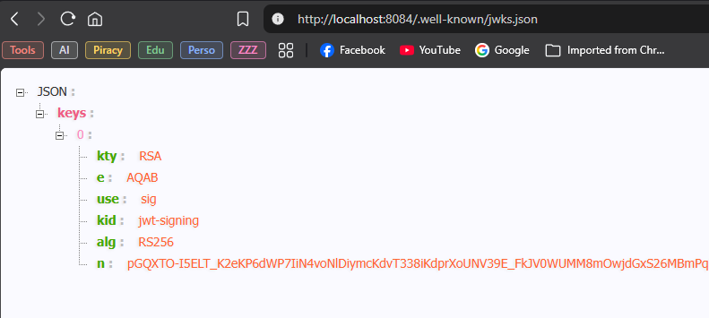

Les contrôles portent sur la signature, l'émetteur (`iss`), l'audience (`aud`), la validité temporelle et les autorisations. Les tokens d'accès utilisés pour la démonstration expirent après **15 minutes**.

### 7.2 Autorisation

| Rôle       | Accès principal                                                               |
| ---------- | ----------------------------------------------------------------------------- |
| `ADMIN`    | Administration des clients et des comptes ; opérations bancaires autorisées   |
| `CUSTOMER` | Consultation de ses propres données ; opérations depuis ses comptes autorisés |

Le token d'un utilisateur client contient une association serveur `customerId`. Les services utilisent `@PreAuthorize` et des vérifications d'appartenance pour interdire l'accès aux comptes d'autres utilisateurs.

### 7.3 Défense en profondeur

- **Gateway** rejette les requêtes sans authentification lorsque l'API est protégée.
- **Customer Service et Account Service** valident eux-mêmes les JWT et les permissions.
- **OpenFeign** relaie explicitement le JWT validé lors des demandes utilisateur.
- **Swagger UI** propose l'authentification Bearer pour tester les endpoints.
- Les mots de passe, clés RSA et tokens Discord sont fournis par des variables d'environnement ou fichiers externes, non committés.

---

## 8. Diagrammes de conception

### 8.1 Modèle métier principal

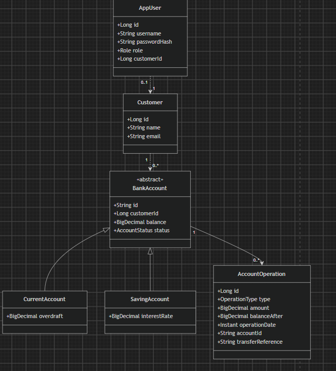

### 8.2 Séquence : ouverture d'un compte

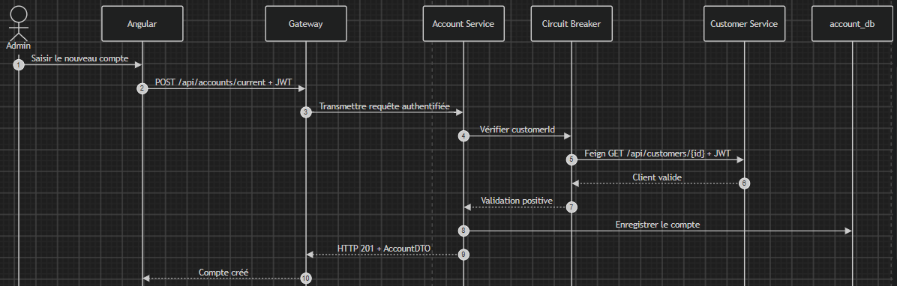

### 8.3 Séquence : virement atomique

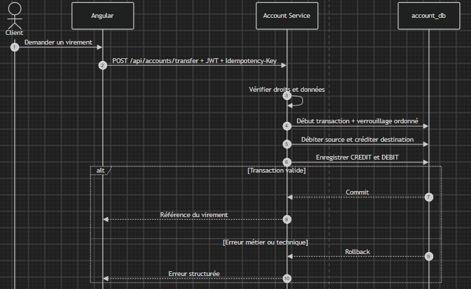

---

## 9. Implémentation

### 9.1 Tableau de bord Eureka

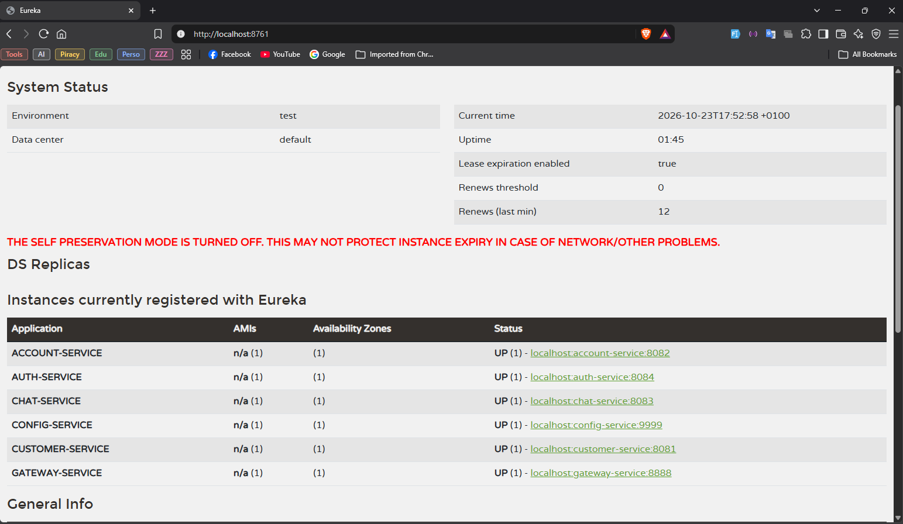

URL : `http://localhost:8761` — vérification de l'enregistrement des services.

### 9.2 Swagger UI centralisé

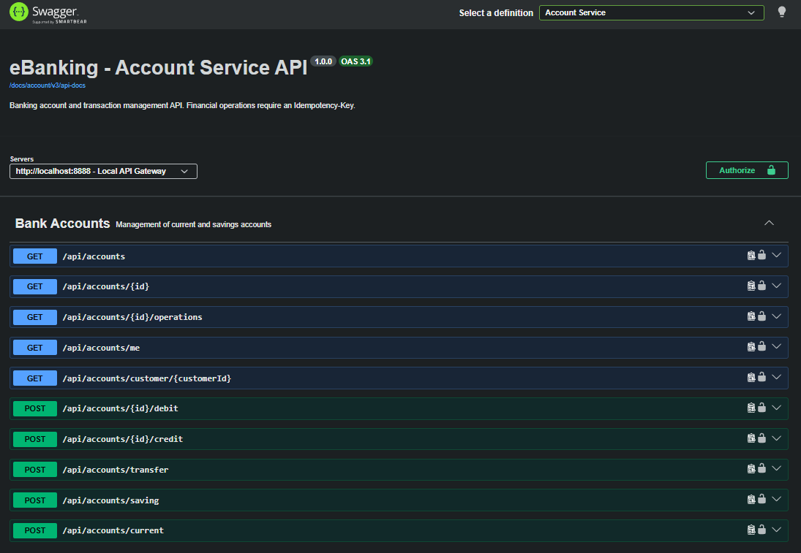

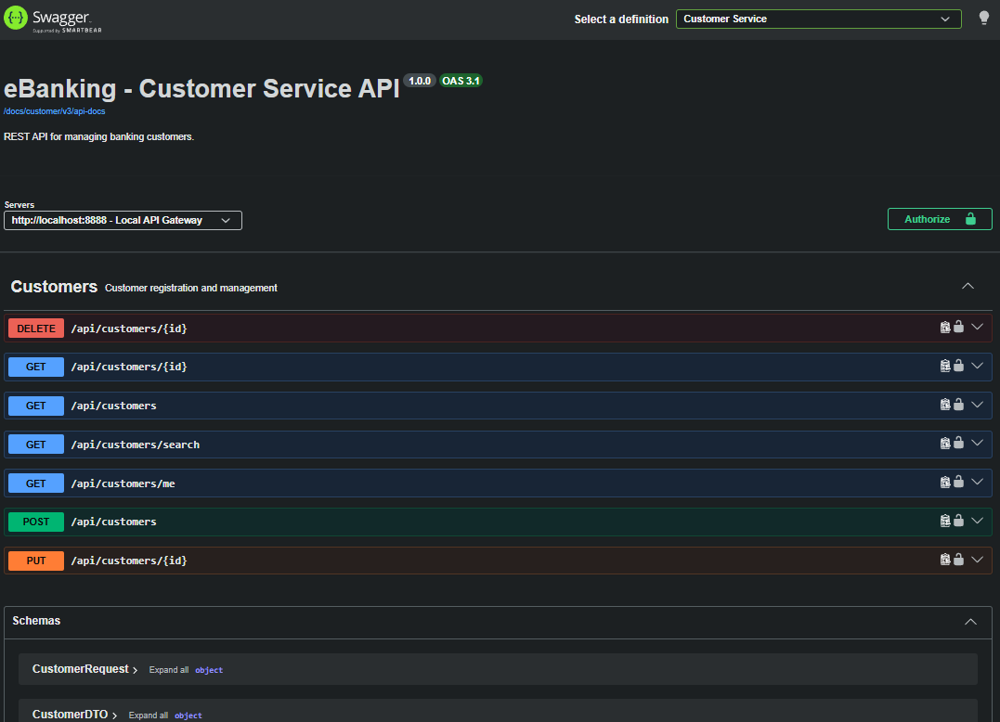

URL : `http://localhost:8888/swagger-ui/index.html` — sélection des spécifications Customer Service et Account Service, puis tests avec un token JWT.

### 9.3 Interface Angular

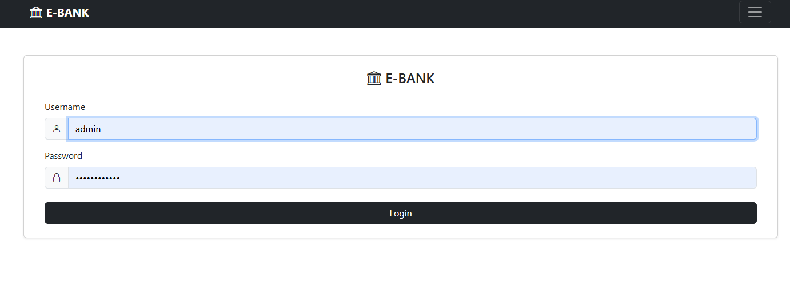

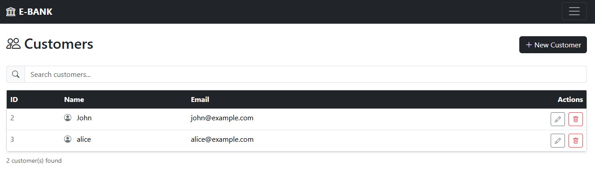

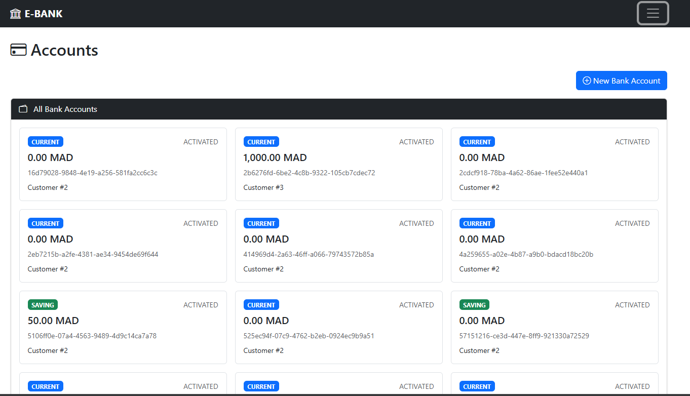

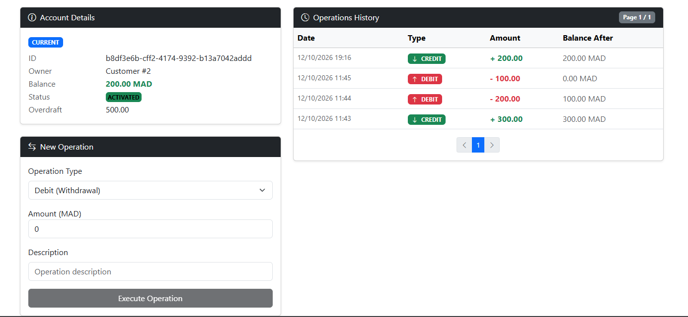

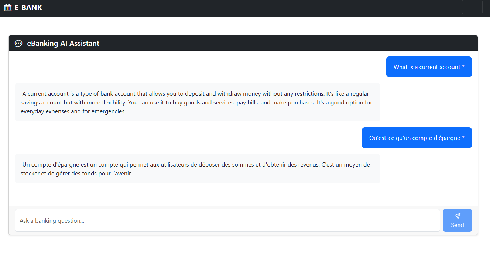

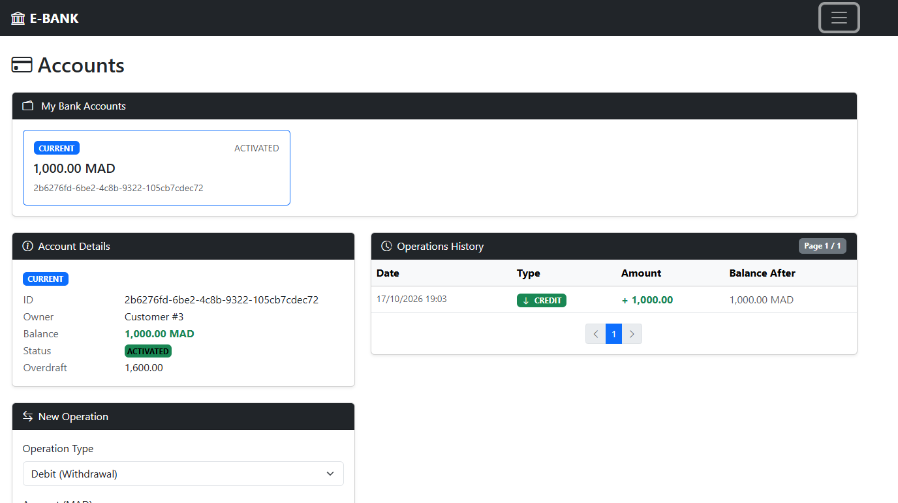

URL : `http://localhost:4200` — parcours de connexion, gestion des clients, gestion des comptes, opérations et chat IA.

### 9.4 Assistant Discord

La commande `/ask question: ...` permet de démontrer une autre interface utilisant exactement la même logique Spring AI/Ollama.

---

## 10. Tests et validation

Les scénarios suivants ont été vérifiés au cours de la construction progressive du projet, d'après les essais fonctionnels réalisés localement :

| Domaine        | Vérifications réalisées                                                         |
| -------------- | ------------------------------------------------------------------------------- |
| Infrastructure | Inscription Eureka, lecture Config Server et routage Gateway                    |
| Customers      | CRUD, recherche, validation et remontée des erreurs                             |
| Accounts       | Création courant/épargne, consultation, débit, crédit et virement               |
| Intégrité      | Solde disponible, historique paginé, verrouillage et protection des doublons    |
| Feign          | Vérification interservices et relais explicite du JWT                           |
| Résilience     | Scénarios `CLOSED`, `OPEN`, `HALF_OPEN`, indisponibilité et rétablissement      |
| Swagger        | Génération des spécifications et interface centralisée                          |
| Sécurité       | Connexion ADMIN/CUSTOMER, 401/403, accès aux ressources propriétaires           |
| Angular        | Parcours clients/comptes, opérations, erreurs avec Signals, création de comptes |
| IA             | Appel Ollama via Spring AI et via Angular                                       |
| Discord        | Commande `/ask`, réponse différée, arrêt/reprise d'Ollama                       |

---

## 11. Conclusion

La refonte d'eBanking a permis de transformer un projet bancaire monolithique en une application distribuée reposant sur des technologies Spring modernes.

Elle a notamment consolidé les compétences suivantes :

- **Architecture microservices :** services spécialisés, bases indépendantes, découverte et configuration centralisée.
- **Communication et résilience :** REST, Gateway, OpenFeign, Circuit Breaker et gestion des défaillances.
- **Sécurité :** émission et validation de JWT RSA, autorisation par rôle et contrôle d'appartenance aux comptes.
- **Frontend moderne :** Angular standalone, RxJS, Signals et formulaires réactifs.
- **IA locale :** Spring AI et Ollama, avec exposition d'un même assistant depuis le web et Discord.
